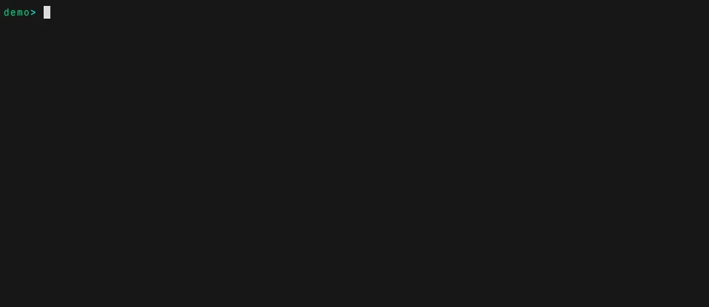
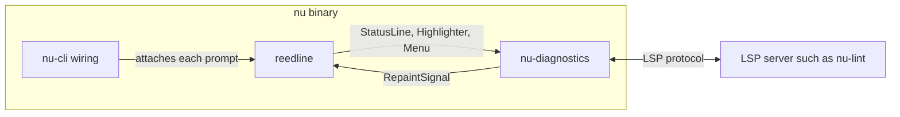

# nu-diagnostics

Shows LSP diagnostics inline in the Nushell REPL as you type. It is a generic LSP _client_, the opposite of the built-in `nu --lsp` server: instead of serving diagnostics, it consumes them from any language server and renders them under your input. It is intended for use with [nu-lint](https://codeberg.org/wvhulle/nu-lint) but works with any LSP server.

Features:

- Multiple underlined spans
- Inline hints under spans
- Configurable colors for error / warning / info / hint level
- Automatic fixes (for most rules)
- User / workspace ignore action (for noisy rules)

Inline diagnostics while typing:



The fix menu suggesting and applying fixes:


## Usage

List one or more language servers in `$env.config.diagnostics.servers`. Each record takes a `command` (required, the program and its arguments as a list) plus optional `language_id` (default `nushell`) and `uri_scheme` (default `file`):

```nu
$env.config.diagnostics.servers = [
    { command: [nu-lint --lsp], language_id: nushell, uri_scheme: repl }
    # Add more servers here; diagnostics from all of them are shown inline.
]
```

Two fields drive how a server sees your input:

- **`language_id`** picks the file extension the input is presented as, so the server treats it as the right language: `nushell` → `.nu`, `bash` → `.sh`, `rust` → `.rs`, `python` → `.py`, and so on.
- **`uri_scheme`** picks the document URI:
  - `"file"` (default) presents the input as a real file `./.reedline-repl.<ext>` in the current directory. Use this for servers that resolve project config by path, such as **ast-grep** (it needs to find `sgconfig.yml`).
  - `"repl"` presents it as `repl:///repl.<ext>`. Use this for servers that filter out REPL-inappropriate actions, such as **nu-lint**.

Servers start once and keep running across prompts. They restart when this configuration or the current directory changes, so a server always sees the project you are in.

### Server configurations

`nu-lint` linting your Nushell input (run from anywhere):

```nu
$env.config.diagnostics.servers = [
    { command: [nu-lint --lsp], language_id: nushell, uri_scheme: repl }
]
```

[ast-grep](https://ast-grep.github.io/) with a rule set: run `nu` from inside the ast-grep project so `sgconfig.yml` resolves. Match `language_id` to the rules' `language:` field, e.g. bash rules ([ast-grep-git-to-jj](https://github.com/wvhulle/ast-grep-git-to-jj)):

```nu
$env.config.diagnostics.servers = [
    { command: [ast-grep lsp], language_id: bash, uri_scheme: file }
]
```

...or Rust rules ([ast-grep-intro](https://github.com/wvhulle/ast-grep-intro)):

```nu
$env.config.diagnostics.servers = [
    { command: [ast-grep lsp], language_id: rust, uri_scheme: file }
]
```

### Appearance

Message and underline colors come from `$env.config.color_config`. A style's foreground also colors the underline:

```nu
$env.config.color_config.diagnostic_error = "red"
$env.config.color_config.diagnostic_warning = "yellow"
$env.config.color_config.diagnostic_info = "blue"
$env.config.color_config.diagnostic_hint = "dark_gray"
```

The fix menu is listed in `$env.config.menus` with the layout `diagnostic_fix`. Its `marker`, `style.text` and `style.selected_text` can be changed like those of any other menu:

```nu
$env.config.menus = [
    {
        name: diagnostic_fix_menu
        only_buffer_difference: true
        marker: "fix> "
        type: { layout: diagnostic_fix }
        style: { text: default_italic, selected_text: cyan_bold }
    }
]
```

### Experimental option

The feature sits behind the `inline-diagnostics` experimental option. This fork turns it on by default, and nothing runs until a server is configured. To turn it off, which also ignores the server list:

```bash
nu --experimental-options '[inline-diagnostics=false]'
```

### Key bindings

- Open the fix/ignore menu when a violation is detected: `ctrl+.`
- Navigate between fixes and ignore actions: `tab`
- Apply a fix directly in the prompt: `enter`

`ctrl+.` is an ordinary Nushell keybinding named `diagnostic_fix_menu`, so it appears in `$env.config.keybindings` and follows the usual rules. Terminals only report `ctrl+.` with keyboard enhancement, so if it does nothing, try `$env.config.use_kitty_protocol = true`.

To move it to another key, assign an entry with the same name. Use `=`, which merges by name. `++=` keeps both keys and warns about the shared name:

```nu
$env.config.keybindings = [
    {
        name: diagnostic_fix_menu
        modifier: alt
        keycode: char_f
        mode: [emacs vi_insert vi_normal]
        event: { send: menu, name: diagnostic_fix_menu }
    }
]
```

### Migrating from `REEDLINE_LSP_SERVERS`

Earlier versions of this fork were configured differently:

- `$env.REEDLINE_LSP_SERVERS` and the `REEDLINE_LS`, `REEDLINE_LS_LANG` and `REEDLINE_LS_SCHEME` variables no longer have any effect. Use `$env.config.diagnostics.servers`.
- `command` is now a list, so `"nu-lint --lsp"` becomes `[nu-lint --lsp]`.
- The `OpenDiagnosticFixMenu` event no longer exists. Replace `{ send: OpenDiagnosticFixMenu }` with the `menu` event above.

## Examples

Runnable reedline programs that use this crate on its own, without building all of `nu`. The dev shell provides the language servers they start. `single_server` starts `nu-lint` by default, so it works from the repository root. Try typing `let x = echo hello`:

```bash
nix develop
cargo run -p nu-diagnostics --example single_server
```

It also takes a command, language and URI scheme, so it can try any server. The `file` scheme needs a project with an `sgconfig.yml` for `ast-grep`, so run this from inside one, with the path to your nushell checkout:

```bash
cargo run --manifest-path /path/to/nushell/Cargo.toml -p nu-diagnostics --example single_server -- "ast-grep lsp" bash file
```

`multi_server` starts `nu-lint` and `ast-grep` together. From the same kind of project, try typing `let x = echo hello; git status`:

```bash
cargo run --manifest-path /path/to/nushell/Cargo.toml -p nu-diagnostics --example multi_server
```

In all of them, open the fix menu with `ctrl+.` or `alt+f`, move with `tab` and apply with `enter`. Leave with `ctrl+d` on an empty line.

## Architecture



`nu-cli` only reads the configuration and attaches this crate to the line editor. Everything else lives here, split along the data flow:

| Module | Role |
| --- | --- |
| `lsp_position` | Converts UTF-16 LSP positions to and from byte offsets |
| `message_layout` | Turns diagnostics into right-aligned status text |
| `underline_ranges` | Turns diagnostics into underline ranges |
| `fix_entries` | Turns code actions into menu rows and buffer edits |
| `document_uri` | Builds the URI a server sees for the input |
| `server_process` | Runs one server: spawn, handshake, read and write messages |
| `severity_styles` | Maps severities to the configured styles |
| `session` | Owns the servers and the current buffer, and connects everything |
| `highlighter`, `status_line`, `fix_menu` | Implement the reedline traits |

This crate reuses the LSP stack `nu-lsp` already depends on (`lsp-server`, `lsp-types`, `crossbeam-channel`, `url`) and needs no async runtime. Each server is a child process with two threads:

- A writer takes messages from a channel and sends them to the server's stdin. It sends only the latest buffer change from each batch, so a slow server does not fall behind your typing.
- A reader parses the server's stdout, stores published diagnostics and asks for a repaint.

Painting reads the stored diagnostics, which sit behind one `RwLock` per server, and the current buffer behind another. Requests that need an answer, such as code actions, wait on a response channel with a deadline. Dropping the last session handle kills the servers, which ends their threads.

### Known limitations

- An underline covers the whole syntax-highlighted token it touches, even when the server's range covers only part of it.
- Opening the fix menu waits for the servers' replies on the input thread, for up to 200 ms.
- Fixes are read from a code action's `changes`. Its `documentChanges` and bare `Command` actions are ignored.
- Positions are exchanged as UTF-16, the LSP default. A server that counts differently gets wrong ranges after characters outside the Basic Multilingual Plane, such as emoji.

### The remaining reedline patch

This crate works through public reedline APIs except for one small patch in the [wvhulle/reedline](https://github.com/wvhulle/reedline) fork. `nu_ansi_term::Style` cannot express an underline color, so `StyledText` gains `set_underline_color_range`. The same patch clears those ranges on submit, because a highlighter cannot tell that a submit is happening and the underlines would otherwise stay in the scrollback.

## Recordings

The animations are not part of `main`. They are the single commit of the orphan `recordings` branch, so the history of `main` stays free of media.

Each `demos/<scene>.tape` is a [VHS](https://github.com/charmbracelet/vhs) script. VHS records MP4, and `demos/record_scene.nu` encodes it to an animated WebP with ffmpeg, dropping duplicate frames so still moments cost nothing. Each tape is its own derivation, so only tapes whose inputs changed are recorded again.

```bash
nix build .#recordings
```

To publish the result, replacing the branch contents:

```bash
nix run .#publish-recordings -- result git@github.com:wvhulle/nushell.git
```

To add a scene, add a `<scene>.tape` to `demos/`.
